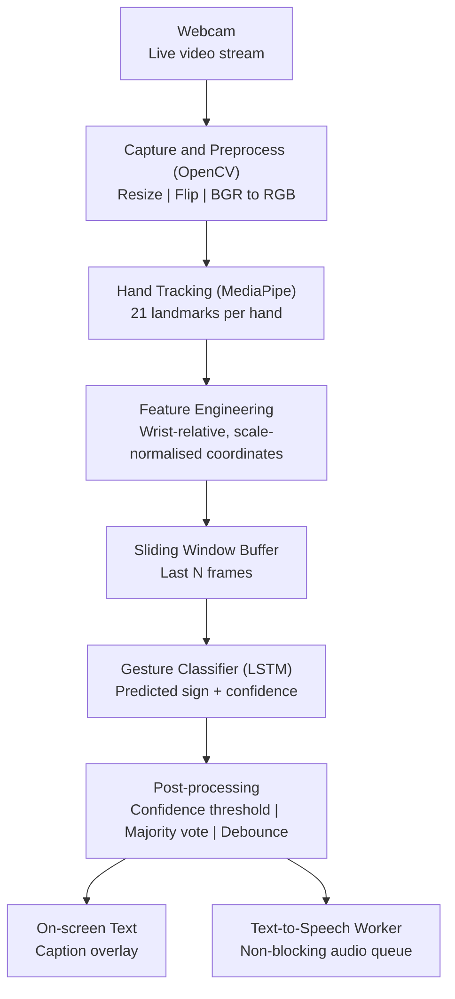
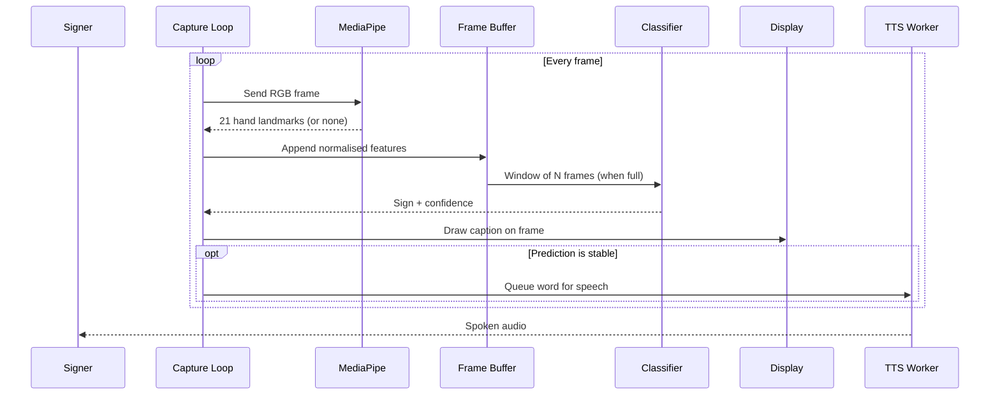

# Real-Time Sign Language to Text 

<!-- TODO: replace with a real screenshot or demo GIF (docs/demo.gif). This is the first thing people look at. -->


*A computer-vision webpage that reads sign language gestures through an ordinary webcam and turns them into on-screen text and spoken audio as they happen. It tracks hands with MediaPipe, classifies movement over time (not single frames) with a sequence model, and keeps the whole loop fast enough to hold a conversation. No gloves, no depth camera, no special hardware.*

## Problem Statement

**#3: Sign language to text in real time** *(submitted by Princy)*

> Build a computer-vision webpage that reads hand gestures through an ordinary webcam and turns sign language into written text or spoken audio as it happens, closing the gap between signers and people who do not sign. The hard parts are tracking hands reliably, classifying movement rather than single frames, and keeping the whole loop fast enough to hold a conversation.

## Full Web Page in Short

The webcam streams frames to OpenCV. MediaPipe finds the hand(s) and returns 21 landmarks per hand. Those landmarks are normalised and pushed into a sliding window of recent frames. A sequence model reads the window and predicts a sign with a confidence score. Once a prediction is stable, the word is drawn on screen and handed to a background text-to-speech worker so audio never blocks the video loop.


## Features Implemented

- Live webcam capture with low-latency frame processing.
- Hand landmark tracking (21 3D points per hand) using MediaPipe.
- Landmark normalisation so results do not depend on hand size or distance from the camera.
- Movement-aware classification over a sliding window of frames, not single-frame guesses.
- Confidence thresholding and prediction smoothing to stop flickering output.
- Real-time text caption overlay on the video feed.
- Non-blocking text-to-speech so speech never freezes the camera loop.
- Runs on a normal laptop with a standard webcam.

## How We Approached the Problem

The problem statement names three hard parts, so the design is built around them.

**1. Tracking hands reliably.** Instead of feeding raw pixels to a model, we use MediaPipe to reduce each frame to 21 landmarks per hand. This makes the system far less sensitive to lighting, skin tone and background than a pixel-based CNN. Coordinates are made relative to the wrist and scaled, so the same sign looks the same at different distances.

**2. Classifying movement, not single frames.** Many signs are defined by motion, so a single frame is not enough. We keep a sliding window of the last N frames of landmark data and classify the whole sequence with an LSTM. Predictions only count once they pass a confidence threshold and stay stable for a few consecutive windows.

**3. Keeping the loop fast.** Landmarks are tiny compared with images, so the classifier is small and quick. Text-to-speech runs in its own thread with a queue, so audio playback never delays the next frame.

<!-- TODO: edit the three paragraphs above so they describe exactly what your code does (window size, model type, thresholds). -->

## Trade-offs We Made

- **Landmarks instead of raw images:** faster and more robust to lighting, but we lose facial expression and body posture, which matter in real sign languages.
- **Small sequence model (LSTM) instead of a large Transformer:** trains on a small dataset and runs in real time on a laptop CPU, but it is limited to short, isolated signs.
- **Restricted vocabulary:** we focused on getting a smaller set of signs accurate and fast rather than covering many signs poorly.
- **Offline text-to-speech:** works without internet and responds instantly, but the voice sounds more robotic than cloud services.

<!-- TODO: keep only the trade-offs that are true for your project. -->

# Web page Architecture



## Flow Summary

*Step-by-step breakdown of what happens on every frame*

### `01` Entry Point

**`main.py`** opens the webcam, loads the trained model, starts the text-to-speech worker and runs the main loop.

### `02` Capture and Preprocessing

OpenCV reads a frame, mirrors it for a natural feel and converts it to RGB for MediaPipe.

### `03` Hand Landmark Extraction

MediaPipe returns 21 landmarks per hand. If no hand is found, the frame is skipped and the buffer is handled gracefully.

### `04` Feature Engineering

Landmarks are made wrist-relative and scale-normalised, then flattened into one feature vector per frame.

### `05` Temporal Buffering

The last N feature vectors are kept in a sliding window so the model sees motion, not just a pose.

### `06` Classification

The sequence model predicts a sign and a confidence score for the current window.

### `07` Post-processing

A prediction is accepted only if it passes the confidence threshold and stays consistent across several windows. This removes flicker and accidental triggers.

### `08` Output

The accepted word is drawn on the video feed and pushed to the text-to-speech queue, which a background thread speaks aloud.

## Tech Stack

*Exact versions are pinned in `requirements.txt`*

### Core

| **Python**   3.8+ | **OpenCV**   Video capture | **MediaPipe**   Hand tracking | **NumPy**   Numerics |
| ----------------- | -------------------------- | ----------------------------- | -------------------- |

### Machine Learning

| **`[TensorFlow / PyTorch]`**   Sequence model | **`[scikit-learn]`**   Utilities / metrics |
| --------------------------------------------- | ------------------------------------------ |

### Speech and Interface

| **`[pyttsx3 / gTTS]`**   Text-to-speech | **`[OpenCV window / Tkinter / Streamlit]`**   Interface |
| --------------------------------------- | ------------------------------------------------------- |

<!-- TODO: keep only the libraries you actually use. -->

## Component Interaction Flow



## Project Structure

```text
realtime-sign-language-to-text/
├── data/                  # Dataset samples and training logs
├── models/                # Trained model weights (.h5 / .pkl)
├── utils/                 # Landmark extraction and preprocessing helpers
├── main.py                # Entry point: launches the real-time app
├── requirements.txt       # Python dependencies
├── .gitignore
└── README.md
```

<!-- TODO: update this tree to match your real repo, including any training or data-collection scripts. -->

## Quick Start

*Get up and running in a few minutes*

### Prerequisites

| **Python**   3.8 or higher | **Webcam**   Built-in or USB | **Git**   To clone the repo |
| -------------------------- | ---------------------------- | --------------------------- |

### `01` Clone the Repository

```bash
git clone https://github.com/Ayush-Chaudhary-02/realtime-sign-language-to-text.git
cd realtime-sign-language-to-text
```

### `02` Create and Activate a Virtual Environment

```bash
python -m venv venv

# Windows
venv\Scripts\activate

# macOS / Linux
source venv/bin/activate
```

### `03` Install Dependencies

```bash
python -m pip install --upgrade pip
pip install -r requirements.txt
```

### `04` Run the Application

```bash
python main.py
```

Allow camera access if your operating system asks.

### Controls

| Key | Action |
| --- | ------ |
| `cmd+q` | Quit the web pge |

### Tips for Best Results

- Use even, bright lighting and face the camera.
- Keep your hand(s) fully inside the frame.
- A plain background gives the most stable tracking.
- Pause briefly between signs so each one is registered cleanly.

## Supported Signs

| Sign / Word | Notes |
| ----------- | ----- |
| `Peace`  | `v sign` |
| `Silence`  | `Finger on lip` |
| `Yes`  | `Thumbs up` |
| `No` | `Thumbs down`|  

<!-- TODO: list every sign the model can recognise. Judges and users will look for this. -->

## Performance

| Metric | Result |
| ------ | ------ |
| Frame rate | `[60 FPS]` |
<!-- TODO: fill in real measured numbers, or delete this section. Do not guess. -->

## Troubleshooting

| Problem | Fix |
| ------- | --- |
| Camera does not open | Close other apps using the webcam and check camera permissions for your terminal or Python. |
| Wrong camera opens | Change the camera index in `main.py` (for example `0` to `1`). |
| `pip install` fails | Confirm Python 3.8+ and that the virtual environment is active. |
| No voice output | Check system volume and that your text-to-speech library installed correctly. |
| Low FPS or lag | Close heavy apps, improve lighting, or lower the capture resolution. |

## Project Limitations and Assumptions

- Recognises isolated signs and a limited vocabulary; full sentence-level grammar translation is not supported.
- Tracking quality drops in very low light or very cluttered backgrounds.
- Assumes one signer is clearly visible and facing the camera.
- Uses hand landmarks only; facial expressions and body posture are not captured.
- Desktop only; no mobile or browser version yet.
- Trained on a small dataset, so accuracy may drop for signing styles it has not seen.

## Future Roadmap

- [ ] Expand the dataset and vocabulary
- [ ] Add Transformer-based models for continuous signing and sentence-level translation
- [ ] Include facial and body landmarks for richer meaning
- [ ] Improve robustness to lighting and backgrounds
- [ ] Browser version using MediaPipe Web and WebRTC
- [ ] Mobile app for Android and iOS

## Acknowledgements

- [MediaPipe](https://developers.google.com/mediapipe) for hand landmark tracking
- [OpenCV](https://opencv.org/) for video capture and processing
- `[Dataset or other sources you used]`

---

*Made by TEAM: 2392608161-ISHOWCODE
NAME: Yashraj Gurejani
USN: 2392608161
MEMBERS:
2392608012 Yash Khemnani
2392608001 Ayush Chaudhary
2392608100 Shaurya Tripathi
2392608078 Arsh Shukla
2392608008 Priyansh Singh*
*Let's connect on [LinkedIn](https://www.linkedin.com/in/yashraj-gurejani-3a68a340b?utm_source=share_via&utm_content=profile&utm_medium=member_ios)*
